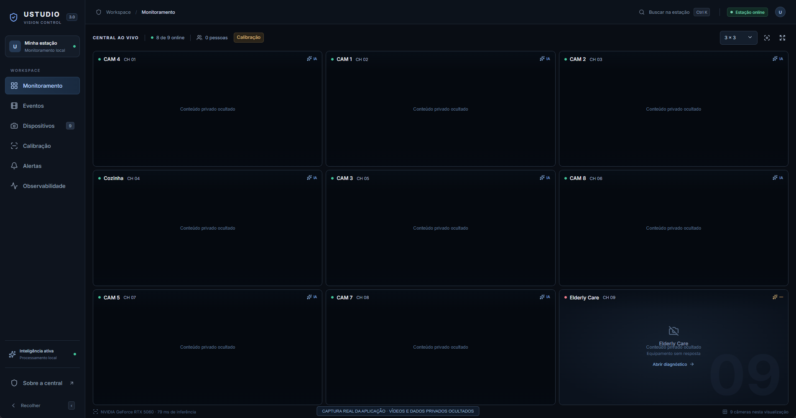
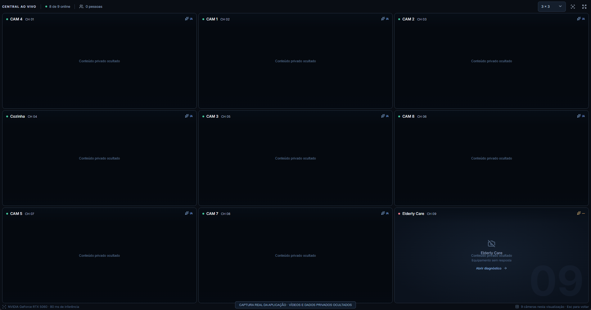
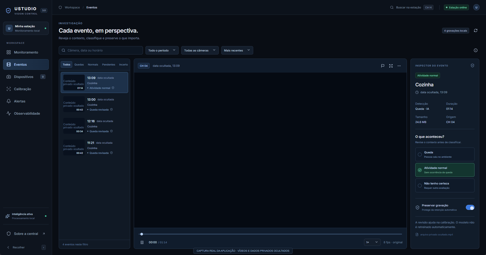
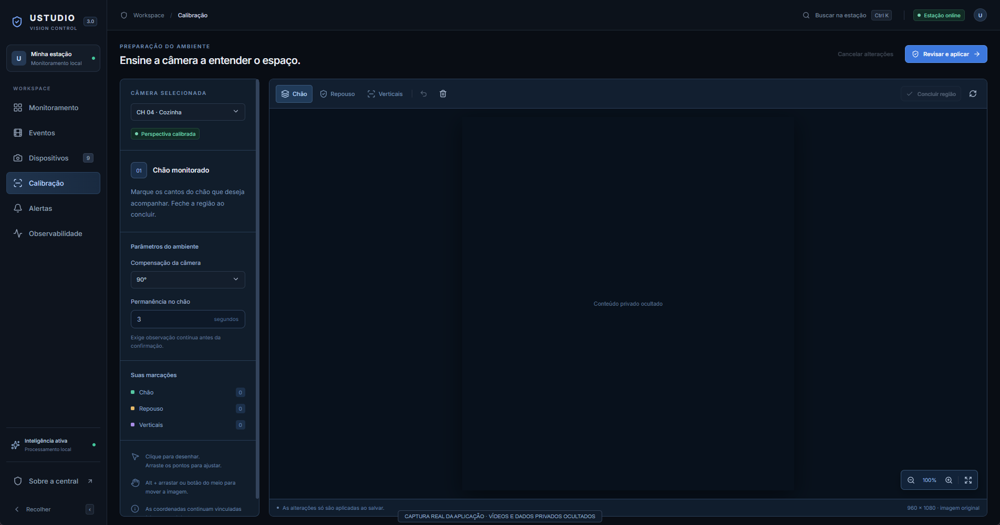
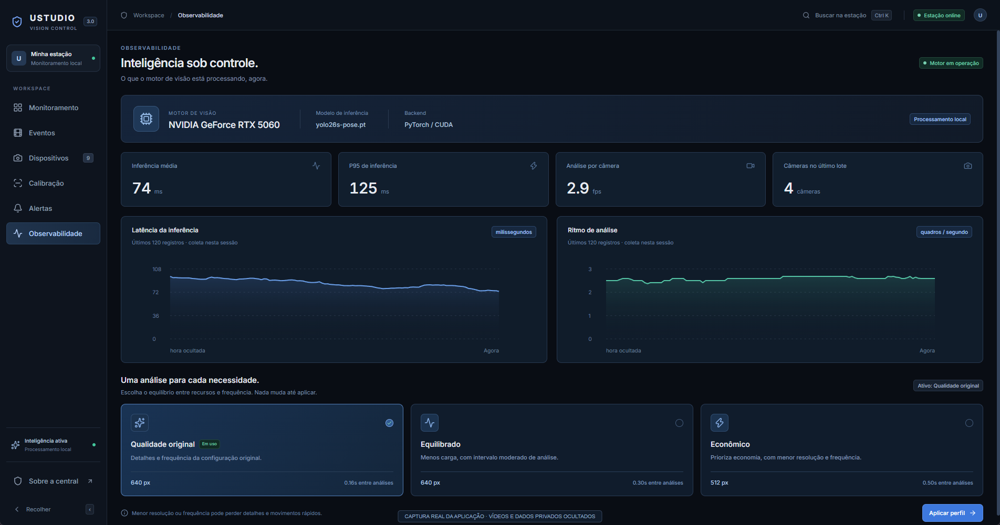
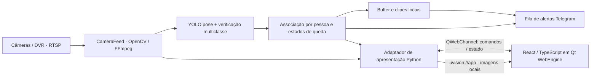

<div align="center">

# UStudio Vision Control

**Videomonitoramento desktop com detecção de pessoas, análise temporal de quedas e alertas pelo Telegram.**


[](LICENSE)

[Repositório](https://github.com/TiagoAbudi/UVision) · [Documentação](docs/README.md) · [Instalação](docs/installation.md) · [Arquitetura](docs/architecture.md) · [Contribuição](CONTRIBUTING.md)

</div>



*Captura real da interface 3.0. Vídeos e dados privados foram ocultados antes da captura. Oito canais estavam conectados e a câmera adicional estava desligada; as áreas ocultadas não representam streams de demonstração.*

## O projeto

O UStudio Vision Control reúne câmeras locais, análise de pessoas e investigação de possíveis quedas em uma estação Windows. O objetivo é auxiliar quem acompanha uma pessoa em um ambiente monitorado: observar a postura ao longo do tempo, guardar o contexto em vídeo e avisar um responsável quando os critérios configurados forem atendidos.

O processamento acontece no computador que executa o aplicativo. A interface é React/TypeScript dentro de uma janela Qt, sem servidor HTTP para o desktop. A inferência, a captura e os registros continuam em Python. O Telegram recebe imagens e clipes quando a integração está habilitada; portanto, esses envios saem da rede local.

**É um projeto experimental.** Existem falsos positivos e falsos negativos. Não há validação clínica nem precisão comprovada em uma população independente; o sistema não substitui supervisão humana ou equipamento de emergência certificado.

## O que está disponível

| Área | Recursos implementados |
|---|---|
| Monitoramento | Oito canais de DVR e uma câmera adicional opcional; mosaico sem rolagem, layouts automático/1×1/2×2/3×3/4×4, paginação, reordenação, ampliação e modo operacional. |
| Pessoas e quedas | YOLO de pose, verificação multiclasse contra animais/veículos, associação temporal por pessoa e estados independentes por câmera. Caixas suavizadas são apenas apresentação. |
| Eventos e vídeos | Buffer anterior ao evento, clipe após confirmação, biblioteca com filtros, reprodução e velocidades de 0,5× a 2×, classificação e preservação. |
| Alertas | Bot Telegram, canais selecionáveis, imagem seguida de vídeo, lembretes, confirmação de recebimento e histórico persistido. |
| Calibração | Regiões de chão e repouso, referências verticais, orientação e tempo de permanência; desenho, arraste, zoom e desfazer. |
| Diagnóstico | Estado de conexão, idade dos quadros, reconexões, FPS do stream/análise, média e p95 de inferência e perfis de desempenho. |

Os caminhos RTSP e o PTZ são específicos dos equipamentos integrados. O aplicativo **não é um cliente universal para qualquer câmera ONVIF**. Consulte [compatibilidade de câmeras](docs/cameras.md).

## Por dentro da interface

Todas as capturas abaixo são do aplicativo em execução, com ocultação de conteúdo privado. A [galeria completa](docs/images/README.md) explica o que foi ocultado e contém as dez vistas solicitadas.

| Monitoramento | Investigação |
|---|---|
|  |  |
| Modo operacional prioriza os vídeos; layouts e ordem são persistidos. | Biblioteca, timeline, velocidade, classificação e proteção no mesmo workspace. |

| Calibração | Observabilidade |
|---|---|
|  |  |
| Marcações usam coordenadas normalizadas da imagem bruta. | Gráficos mostram amostras da execução real, sem métricas simuladas. |

[Câmera individual](docs/images/camera-detail.png) · [Histórico de eventos](docs/images/recordings.png) · [Central de alertas](docs/images/alerts.png) · [Configuração do bot](docs/images/alert-settings.png) · [Dispositivos](docs/images/devices.png)

## Arquitetura em uma vista



Um único backend mantém os streams e os modelos. O frontend recebe estado e imagens dos canais visíveis, sem duplicar a captura. Veja [componentes e transporte](docs/architecture.md) e [fluxo de processamento](docs/diagrams/processing-flow.md).

## Tecnologias verificadas

| Camada | Implementação |
|---|---|
| Runtime | Python 3.12; pacote exige `>=3.12,<3.13` |
| Desktop | PySide6 6.12, Qt WebEngine e Qt WebChannel |
| Interface | React 19, TypeScript 7, Vite 8, Radix, Lucide e fonte Inter local |
| Inferência | Ultralytics 8.4.189, PyTorch 2.11 / torchvision 0.26, distribuição CUDA 12.8 |
| Modelos usados nesta configuração | `yolo26s-pose.pt` e `yolo26s.pt`; pesos oficiais obtidos separadamente |
| Vídeo | OpenCV 5; FFmpeg externo com `libx264` para os clipes enviados ao Telegram |
| Persistência | JSON/JSONL locais, MP4 e configurações em `.env`; sem banco externo |
| Verificação | pytest e TypeScript estrito; sem badge de CI ou cobertura não verificados |

As versões exatas estão em [requirements.txt](requirements.txt), [package.json](frontend/package.json) e [package-lock.json](frontend/package-lock.json). A interface se identifica como 3.0; o pacote Python ainda tem versão 0.1.0. Isso não representa uma release pública 3.0.

## Instalação rápida

Ambiente validado: **Windows 11 x64**, Python 3.12 e GPU NVIDIA RTX 5060. A distribuição Python é preparada para CUDA; desempenho de nove câmeras em CPU, Raspberry Pi, outros sistemas ou outras GPUs não foi homologado.

Depois de clonar o conteúdo deste diretório em uma pasta `camera-ai`, execute nela:

```powershell
py -3.12 -m venv .venv
.\.venv\Scripts\python.exe -m pip install --upgrade pip setuptools
.\.venv\Scripts\python.exe -m pip install -r requirements.txt
.\.venv\Scripts\python.exe -m pip install --no-build-isolation -e .
Push-Location frontend
npm.cmd ci
npm.cmd run build
Pop-Location
```

Copie [.env.example](.env.example) para **a pasta pai** como `.env`, somente se o destino não existir; preencha o host e as credenciais do DVR localmente. Baixe os dois modelos oficiais após revisar os termos de uso. Os passos, comandos de verificação e a instalação do FFmpeg estão no [guia de instalação](docs/installation.md).

```powershell
.\.venv\Scripts\python.exe -m camera_ai.desktop_dashboard --self-test
.\.venv\Scripts\python.exe -m camera_ai.desktop_dashboard
```

O comando abre a janela maximizada. Não é necessário iniciar Vite ou um servidor web durante o uso. O `.exe` existente é um **launcher local**, não um instalador portátil; [entenda o build e suas restrições](docs/development.md#build-e-distribuição).

## Primeira operação

1. Verifique os streams e as credenciais em [Câmeras](docs/cameras.md).
2. Comece com `FALL_SHADOW_MODE=true` e alertas externos desativados.
3. Calibre cada enquadramento em [Calibração](docs/calibration.md).
4. Revise atividades normais e testes controlados em [Gravações](docs/recordings.md).
5. Configure e teste o bot em [Alertas](docs/alerts.md), selecionando os canais já revisados.

Atalhos: `Ctrl+K` busca; `Ctrl+1` monitoramento; `Ctrl+2` eventos; `F11` tela cheia; `Esc` retorna da expansão/modo operacional. O player e a calibração também têm atalhos dependentes de foco.

## Limites conhecidos

- Quedas são inferidas por heurísticas temporais sobre poses; os pesos não foram retreinados com os testes locais. Pontuação não é probabilidade.
- Oclusão, animais, perspectiva, pouca luz e movimento podem gerar erros. Alterar posição da câmera exige recalibração.
- São até nove posições na interface atual; aumentar esse limite exige trabalho de integração e validação.
- O WebEngine acrescenta consumo de RAM. Menor resolução de análise pode reduzir custo, mas exige reavaliar a detecção.
- Vídeos do player não têm áudio. Marcadores manuais duram somente a sessão; não há timestamp automático preciso de queda na timeline.
- A retenção é por contagem de clipes não protegidos, não por dias ou espaço livre. Logs, cache Telegram e arquivos protegidos exigem gestão de armazenamento.
- Monitoramento para quando o computador/aplicativo está desligado ou suspenso. Não há serviço Windows, nuvem, app móvel ou instalador universal implementados.

Consulte [diagnóstico e soluções](docs/troubleshooting.md) e [limitações da IA](docs/ai-detection.md).

## Desenvolvimento, segurança e licença

Comece pelo [guia de desenvolvimento](docs/development.md) e pelas [orientações de contribuição](CONTRIBUTING.md). Vulnerabilidades e dados pessoais seguem [SECURITY.md](SECURITY.md). Não inclua gravações, credenciais, logs, calibrações locais ou pesos em commits.

O **código próprio e sua documentação são disponibilizados sob a [licença MIT](LICENSE)**, escolhida pelo responsável. Essa licença não altera os termos de dependências, modelos, fontes ou ícones. Em especial, a integração Ultralytics/YOLO mantém suas condições AGPL-3.0 ou empresariais; distribuir a aplicação integrada exige cumprir os termos aplicáveis. Consulte [licenciamento e escopo](docs/licensing.md) e os [avisos de terceiros](THIRD_PARTY_NOTICES.md).

O [changelog](CHANGELOG.md) registra apenas alterações verificáveis. O [guia de publicação](docs/publication.md) reúne a auditoria, as pendências e os comandos para publicar sem incluir os dados da instalação.
