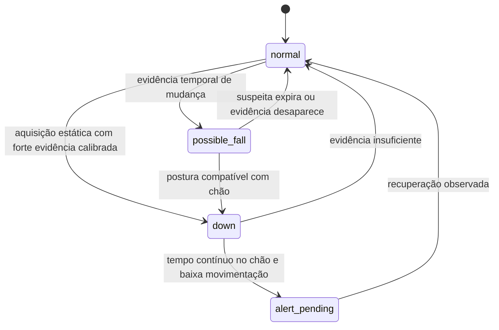
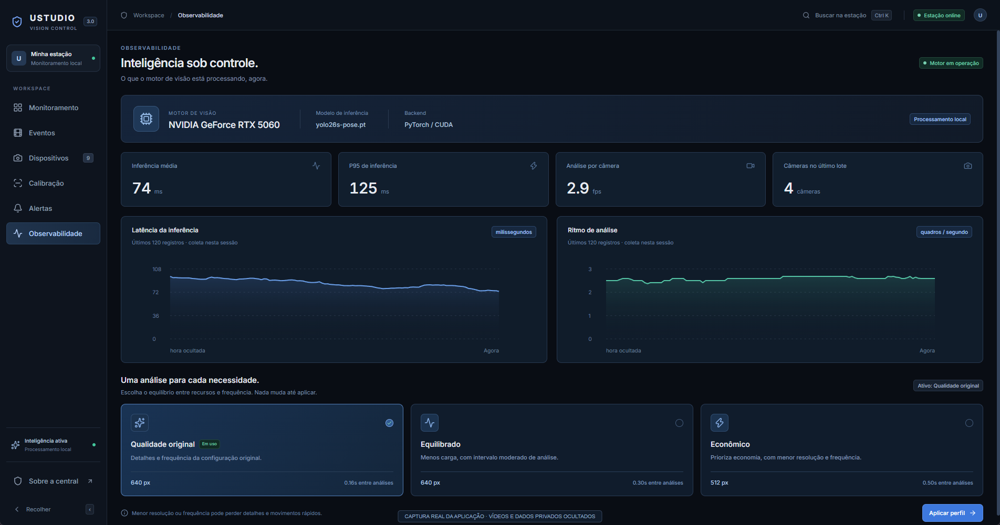

# Detecção por inteligência artificial

## Modelos efetivamente usados

O componente é `YoloPersonDetector`, em `detection/yolo_detector.py`, usando Ultralytics sobre PyTorch. A configuração recomendada e usada na estação é `yolo26s-pose.pt` para caixas e 17 pontos corporais, com `yolo26s.pt` para verificar evidência independente de pessoa contra animais, veículos e outros objetos na região candidata. Os pesos oficiais precisam ser obtidos separadamente, conforme a [instalação](installation.md#5-obter-modelos-oficiais).

O default interno `yolo26n.pt` é um detector de caixas; ele não fornece poses para o mesmo fluxo de quedas. O arquivo `yolo26n-cls.pt` encontrado entre os experimentos locais não integra o pipeline atual. Não há classificador treinado especificamente para “queda” nem reidentificação de pessoas.

O verificador adicional reduz erros, mas não elimina confusão com animais ou objetos. Não se deve comparar diretamente escores de redes diferentes como se tivessem a mesma calibração. Os pesos não foram retreinados com os vídeos da instalação; houve ajuste das regras e da perspectiva.

## Da pose à confirmação

As características incluem proporção da caixa, inclinação do tronco, velocidade do centro, mudança de postura, confiança/pontos visíveis, zonas e desvio dos eixos corporais em relação à vertical projetada. Cada pessoa associada mantém um monitor temporal por canal.

O estado `down` precisa acumular ao menos `FALL_GROUND_CONFIRM_SECONDS` de evidência confiável e pelo menos dois segundos de baixa movimentação antes de `alert_pending`. Perder a pose reinicia esses contadores; um frame congelado não conta como permanência no chão. Suspeitas que não progridem expiram. A pontuação exibida é heurística, não probabilidade.

Existe uma via para readquirir alguém já imóvel após uma interrupção: exige perspectiva calibrada, forte desvio de tronco e pernas, corpo horizontal, pose completa, confiança elevada e evidências repetidas. Ela não reutiliza o tempo anterior à perda. Isso tenta reduzir uma falha conhecida sem relaxar a confirmação para qualquer caixa horizontal.

## Múltiplas câmeras e GPU

O worker serve até quatro câmeras por lote, priorizando as menos recentemente analisadas. Sequências repetidas e frames com mais de um segundo são descartados. O aquecimento não produz evidência de queda. Na GPU, lotes fixos e padding reduzem variação de inicialização, descartando saídas das posições extras. A verificação multiclasse também é compartilhada, sem carregar um modelo por câmera.

`YOLO_DEVICE=auto` seleciona CUDA se disponível ou CPU; um índice explícito de GPU falha se CUDA não estiver disponível. A GPU usa o caminho de inferência configurado pelo código para menor precisão numérica, e a CPU continua disponível como fallback de dispositivo. A RTX 5060 foi usada na validação local; isso não comprova desempenho em Raspberry Pi, CPU de baixo consumo ou outro acelerador.

## O que cada métrica significa

| Métrica | Interpretação |
|---|---|
| FPS do vídeo | Taxa observada de quadros recebidos/decodificados de cada stream; diferente da taxa de análise. |
| FPS de análise | Frequência de resultados publicados para a câmera. Varia com número de canais, lotes e custo do modelo. |
| Tempo de inferência | Tempo medido do trabalho do lote, incluindo etapas de pose e verificação; não é tempo de aviso até o celular. |
| Média | Média da janela recente de tempos de inferência. |
| P95 | Percentil aproximado dos tempos recentes: destaca a cauda de execuções mais lentas; não mede precisão. |
| Latência do resultado | Idade do resultado associado à câmera, distinta da idade do último frame recebido. |

Os gráficos da interface acumulam até 120 amostras reais na sessão; não são telemetria persistida por dias. A taxa de desenho dos canvas e o FPS configurado do MP4 são outras cadências distintas.

## Perfis de desempenho

| Perfil na interface | Resolução IA | Intervalo alvo | Maior lado da imagem preparada |
|---|---|---|---|
| Qualidade original | `YOLO_IMAGE_SIZE` | `DVR_DETECTION_INTERVAL` | Sem redução prévia pelo perfil |
| Equilibrado | 640 | 0,30 s | 1280 px |
| Econômico | 512 | 0,50 s | 960 px |

Escolher um cartão só prepara a seleção; **Aplicar perfil** persiste em `runtime/performance.json`. O stream principal e os clipes não mudam de resolução por essa ação. Reduzir resolução/cadência diminui observações de postura e exige nova avaliação com atividades normais e eventos controlados. Não há garantia de nove câmeras sem atraso em qualquer computador.

## Limites de validação

Os testes cobrem regras, regressões numéricas e fluxo de mídia; não medem sensibilidade/especificidade em população independente. A base local é privada, pequena e usada também na calibração. Não é um dataset público anotado nem uma validação clínica. Para treinamento futuro, seriam necessárias autorizações, anotações revisadas e separação por sessão/ambiente, evitando dividir frames vizinhos entre treino e teste.

Oclusão, múltiplas pessoas próximas, câmera alta ou móvel, pouca luz, roupas, animais, reflexos e atividades como sentar/agachar podem produzir falsos positivos e falsos negativos. Use supervisão humana e outro meio de emergência adequado ao contexto. Não utilize a pessoa vulnerável para encenar quedas.
