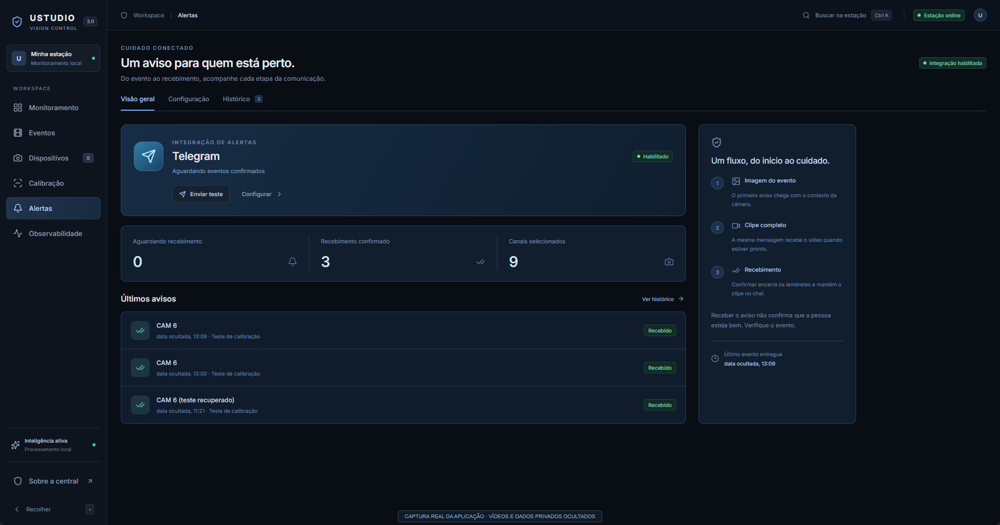
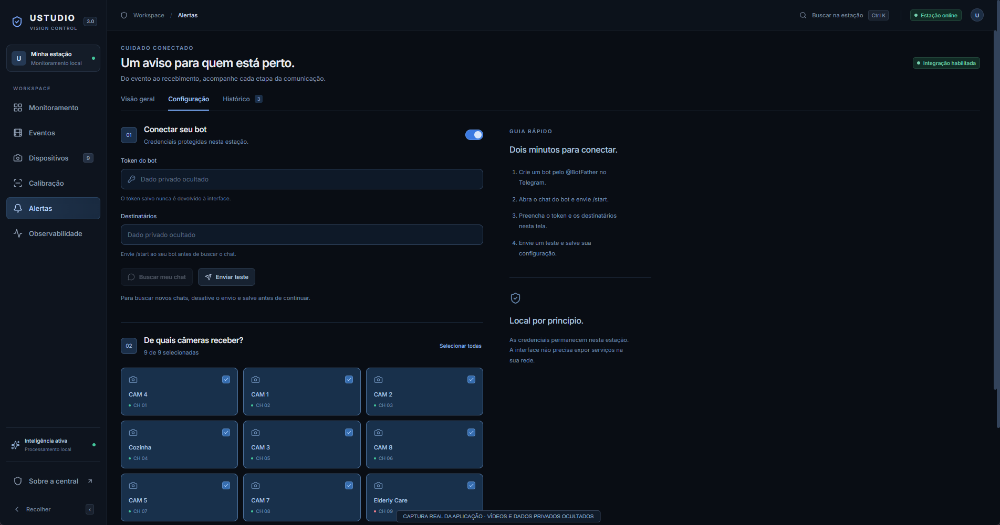
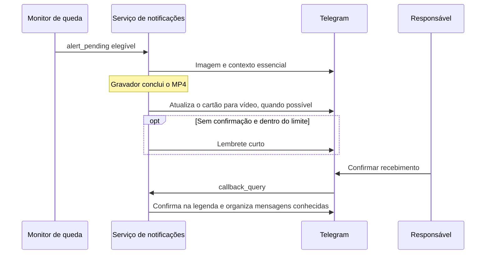

# Alertas pelo Telegram

O bot é opcional e fica desativado no exemplo público. Ao habilitar, imagens e clipes saem do computador e são enviados aos destinatários via Telegram. Confirme as autorizações e o acesso aos chats antes de ativar uma câmera em ambiente privado.

## Criar e conectar o bot

1. No Telegram, crie um bot com o **@BotFather** e guarde o token como segredo.
2. Abra a conversa com o novo bot e envie `/start`. Não basta conversar com o BotFather.
3. No UVision, abra **Alertas → Configuração**, informe o token e busque o chat.
4. Confira os IDs retornados, selecione os destinatários e envie uma mensagem de teste.
5. Selecione os canais e salve com o envio habilitado quando estiver pronto.

`TELEGRAM_CHAT_IDS` são os IDs numéricos dos chats de destino, não nome de usuário, telefone nem ID do bot. A interface aceita até oito, separados por vírgula; grupos podem ter ID negativo. Não publique os seus IDs. Não use sites de terceiros que peçam seu token para descobri-los.

**Buscar meu chat** usa `getUpdates` e exige desativar o envio e salvar antes, para não disputar o polling de recebimentos. Envie `/start` novamente se não houver atualização disponível. Use um bot dedicado: outro consumidor de `getUpdates` ou webhook existente pode impedir a entrega dos cliques. O aplicativo não remove webhooks automaticamente.

O token salvo não é devolvido à interface; deixá-lo vazio conserva o existente. O botão **Enviar teste** envia uma mensagem aos destinatários e não simula uma queda nem valida o encoder de vídeo. A configuração é gravada no `.env` da pasta pai.

## Canais e modo de calibração

`FALL_MONITOR_CHANNELS` define onde a IA analisa quedas; `TELEGRAM_CHANNELS` define quais desses canais podem enviar avisos. Marcar os nove não liga a câmera desligada e não envia toda detecção de pessoa. A origem precisa alcançar `alert_pending`.

Se `FALL_SHADOW_MODE=true`, os avisos só saem quando **Enviar testes de calibração** (`TELEGRAM_ALLOW_CALIBRATION=true`) também está permitido. Nesse caso, chegam identificados como TESTE. O shadow mode não é um bloqueio absoluto de rede quando essa permissão está ativa.

Comece pelos ambientes calibrados e revisados. A configuração de uma instalação existente não é alterada ao atualizar a documentação; o `.env.example` é apenas um exemplo.

## Ciclo da mensagem

O serviço tenta manter um cartão principal por evento. A imagem pode ser substituída pelo clipe; lembretes anteriores são removidos quando o próximo é enviado. Ao confirmar, encerra os lembretes para os destinos do evento e conserva o clipe com informação essencial e recebimento na legenda. Se a confirmação chegar antes do clipe, a imagem permanece até a atualização.

**Confirmar recebimento significa “vi o aviso”, não “a pessoa está bem”.** É necessário verificar a situação. O histórico local registra evento, entregas, disponibilidade do vídeo e confirmação.

## Lembretes, falhas e histórico

O padrão é 90 segundos e três lembretes; a configuração aceita intervalo de 30–3600 segundos e de zero a cinco lembretes. Falhas têm tentativas limitadas e espera progressiva. Fila, mensagens conhecidas e offset ficam em `runtime/events.json`, e o polling dos botões usa worker separado do upload.

A organização do chat opera somente sobre IDs conhecidos do evento. Não varre intervalos de mensagens nem limpa conversas inteiras. Exclusões podem falhar por permissão, idade da mensagem ou limites da API. A [API oficial do Telegram](https://core.telegram.org/bots/api#deletemessage) impõe restrições de exclusão, incluindo o limite usual de 48 horas; mensagens antigas podem exigir limpeza manual. O clipe local não é removido por confirmar ou organizar o chat.

O envio de vídeo exige FFmpeg com `libx264`; verifique também DNS, acesso HTTPS de saída, token válido e início da conversa pelo destinatário. A integração usa a [Bot API](https://core.telegram.org/bots/api) por HTTPS e long polling, sem servidor de entrada do UVision. Veja [falhas de alertas](troubleshooting.md#alertas-não-chegam).
