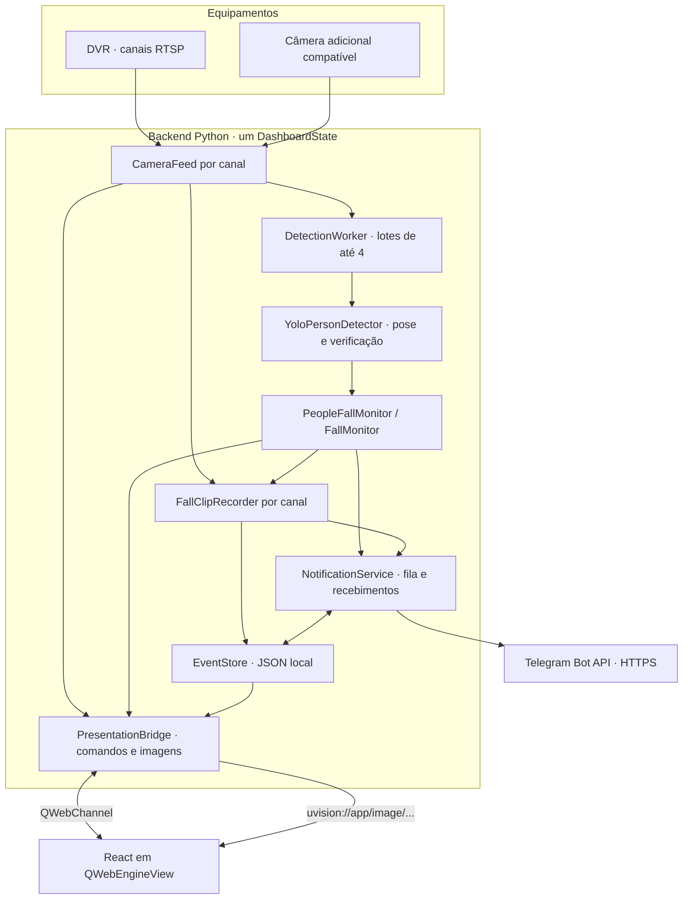

# Arquitetura

## Entrada e interface atual

`camera_ai.desktop_dashboard.main()` configura Qt, log, instância única e a janela maximizada. A interface padrão é `VisionWindow`, definida em `hybrid_ui.py`; `--classic-ui` seleciona explicitamente a interface Qt Widgets anterior. React, TypeScript, Radix, Lucide e CSS são compilados pelo Vite e embarcados no Qt WebEngine. A fonte Inter é local.

O módulo chamado `web_dashboard.py` também contém os serviços compartilhados do desktop. Seu nome não significa que o aplicativo inicia HTTP. O servidor legado só é criado pela entrada específica desse módulo. Classes Tkinter/Qt antigas permanecem no código, mas não são a interface 3.0 padrão.

## Captura e inferência

Cada `CameraFeed` tem uma thread e uma captura OpenCV/FFmpeg RTSP. Mantém o último frame, sequência, timestamp e diagnóstico. O backend não acumula uma fila ilimitada de frames antigos. A captura configura duas threads de decodificação por stream.

`DetectionWorker` escolhe primeiro canais há mais tempo sem análise, até quatro por lote. Evita repetir sequências e descarta frames com mais de um segundo. O `YoloPersonDetector` carrega os modelos uma vez, aquece a GPU e executa pose mais verificação multiclasse. Os resultados são reprojetados quando a análise usa imagem reduzida.

`PeopleFallMonitor` associa detecções por posição/sobreposição, mantendo estados por pessoa em cada câmera. Não existe reconhecimento de identidade nem identificação da avó por nome. O tracking visual por fluxo óptico suaviza caixas entre inferências e não fornece evidência para confirmar quedas.

## Estados, gravação e mensagens

O monitor temporal transita entre `normal`, `possible_fall`, `down` e `alert_pending`. A confirmação depende de postura, histórico, zonas/perspectiva e tempo contínuo. O gravador mantém JPEGs anteriores em memória, só persistindo MP4 quando houve `alert_pending`.

`EventStore` compartilha revisões, proteção, alertas, IDs de mensagens e offset Telegram. Escritas JSON usam arquivo temporário e substituição. A fila de notificações e o polling de recebimentos têm workers separados, para que upload não bloqueie os botões. A conversão H.264 usa um subprocesso FFmpeg e preserva o MP4 original.

## Transporte da apresentação

`PresentationBridge` expõe uma lista explícita de ações ao QWebChannel. Comandos, mídia e PTZ usam executores separados. Não existe REST público ou WebSocket da nova interface. Exemplos de ações internas reais: `bootstrap`, `visible`, `recordings`, `playerOpen`, `playerSeek`, `review`, `protect`, `calibrationLoad`, `calibrationSave`, `telegramSave` e `profile`.

O estado é publicado aproximadamente a cada segundo. O frontend assina os canais visíveis e informa a largura solicitada; um worker prepara somente frames novos, desenha as caixas de apresentação e comprime JPEGs locais. O esquema `uvision://app` serve assets estáticos e imagens em memória através de `QWebEngineUrlSchemeHandler`. Não é um endereço acessível na rede.

O frontend pinta as imagens em canvas sem atualizar toda a árvore React por frame. O player também recebe imagens decodificadas via OpenCV, evitando depender do suporte H.264 do Chromium distribuído. Essa apresentação custa CPU/RAM adicionais; não é zero-copy e não duplica conexões RTSP.

CSP, bloqueio de navegação e interceptor restringem os recursos ao contexto local previsto. Tokens e senhas não fazem parte do DTO. Isso não fornece autenticação multiusuário ou criptografia dos dados em disco.

## Persistência real

| Local relativo ao projeto | Conteúdo |
|---|---|
| `../.env` | Credenciais e configuração privada compartilhada com o bot |
| `calibration/chXX-zones.json` | Regiões, rotação, tempo no chão e invalidação de enquadramento |
| `calibration/chXX-geometry.json` | Perspectiva por canal |
| `runtime/events.json` | Revisões, proteção, alertas, entregas e offset Telegram |
| `runtime/performance.json` | Perfil de análise selecionado |
| `runtime/ui-layout.json` | Layout, ordem e recolhimento da navegação |
| `runtime/dvr-identity.json` | Pareamento local do DVR |
| `runtime/alert-images/`, `runtime/telegram-videos/` | Imagens de alerta e cópias H.264 para entrega |
| `recordings/falls/` | MP4 de eventos confirmados |
| `logs/` | Diagnóstico desktop, eventos e amostras de calibração |

Esses dados são privados e ignorados pelo Git. Não há serviço em nuvem, banco remoto ou painel multiusuário implementado. Veja o [fluxo temporal](diagrams/processing-flow.md).
