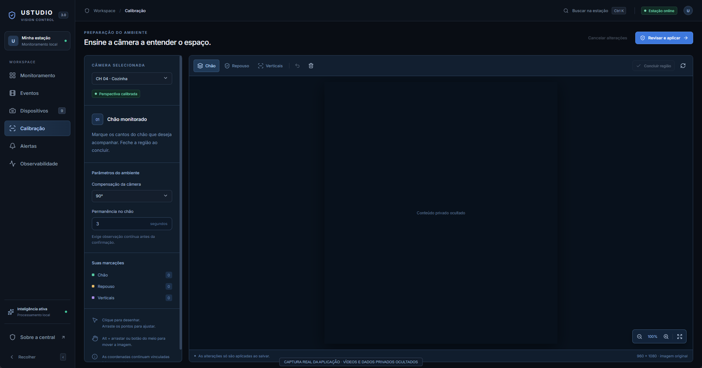

# Calibração por ambiente

A câmera precisa ser calibrada no enquadramento em que será usada. Uma pessoa em pé filmada de cima pode parecer horizontal na imagem; por isso uma caixa larga ou a inclinação contra a borda não bastam para decidir que alguém está no chão.

## Preparar a câmera

1. Fixe posição, lente, orientação e iluminação de uso. Se for PTZ, escolha a posição operacional antes de começar.
2. Confirme que o canal está online e pertence a `FALL_MONITOR_CHANNELS`.
3. Abra **Calibração** e selecione o canal. A imagem é congelada a partir do stream; **Atualizar imagem** obtém outra referência.
4. Escolha orientação e tempo de permanência no chão. A orientação aceita 0/90/180/270 graus; o tempo aceita 1–30 segundos.

O canvas mostra a imagem bruta, inclusive seu aspecto anamórfico quando aplicável. As coordenadas são normalizadas no sistema `raw_image_normalized_xy`, com x/y entre 0 e 1. Não aplique manualmente a correção visual do mosaico às coordenadas.

## Chão, repouso e perspectiva

- **Chão monitorado:** desenhe polígonos da área em que a presença no chão deve ser considerada. Clique para inserir pontos e conclua a região. Sem polígono de chão, o critério de zona não restringe a imagem inteira.
- **Áreas de repouso:** marque regiões como cama/sofá para excluir posturas esperadas. A elegibilidade usa o centro dos quadris visíveis ou, na ausência deles, o centro da caixa; não é uma máscara pixel a pixel do corpo.
- **Perspectiva:** marque ao menos duas referências verticais físicas em posições distintas. O cálculo encontra a direção projetada de uma pessoa em pé; linhas muito curtas, quase paralelas ou degeneradas são rejeitadas.

Use arraste de pontos para corrigir, zoom/pan para enquadrar e desfazer para recuperar a edição anterior. `Ctrl+Z` atua quando o canvas está em foco. Polígonos precisam de ao menos três pontos e área útil; linhas precisam de dois pontos. Não contorne um corpo como se isso treinasse a rede.

## Revisar e salvar

**Revisar e aplicar** apresenta a confirmação dos parâmetros. O backend valida tipos, limites, canal, regiões e perspectiva antes de aplicar os arquivos. As zonas são salvas em `calibration/chXX-zones.json`; referências verticais atualizam o perfil geométrico configurado ou `calibration/chXX-geometry.json`. O monitor daquele canal é recarregado.

Cancelar restaura o estado carregado. Trocar de canal, atualizar a imagem ou sair da área com mudanças pendentes exige descartar explicitamente ou continuar a edição. Salvar regiões não comprova a qualidade da detecção: o perfil manual permanece marcado como não validado até avaliação externa ao simples salvamento.

Se o enquadramento estiver invalidado, são exigidas ao menos duas novas verticais para salvar. Um comando PTZ do UVision marca a mudança; movimentos feitos fora do aplicativo não são detectados automaticamente. Sempre recalibre após mudança física, rotação ou reposicionamento.

## Validar sem transformar a calibração em uma promessa

Comece em shadow mode e observe atividades normais: caminhar, correr, sentar, agachar, trabalhar em bancada e passagem de animais. Revise falsos positivos na biblioteca. Testes de postura no chão só devem ser feitos por adulto apto, de modo controlado e sem impacto; nunca peça que a pessoa vulnerável se jogue no chão.

Registre rótulos e preserve exemplos importantes. Varie iluminação, roupas e posições, separando sessões usadas para ajuste daquelas usadas para avaliação. [Scripts de replay](development.md#replays-e-dados-privados) ajudam a reproduzir casos, mas os datasets locais não são publicados. Compare também falhas de conexão e perda de pose: ausência de alerta não prova ausência de queda.

Não copie os perfis privados da instalação original. São específicos de câmera/enquadramento e foram excluídos da publicação; uma instalação nova começa sem esses arquivos.
