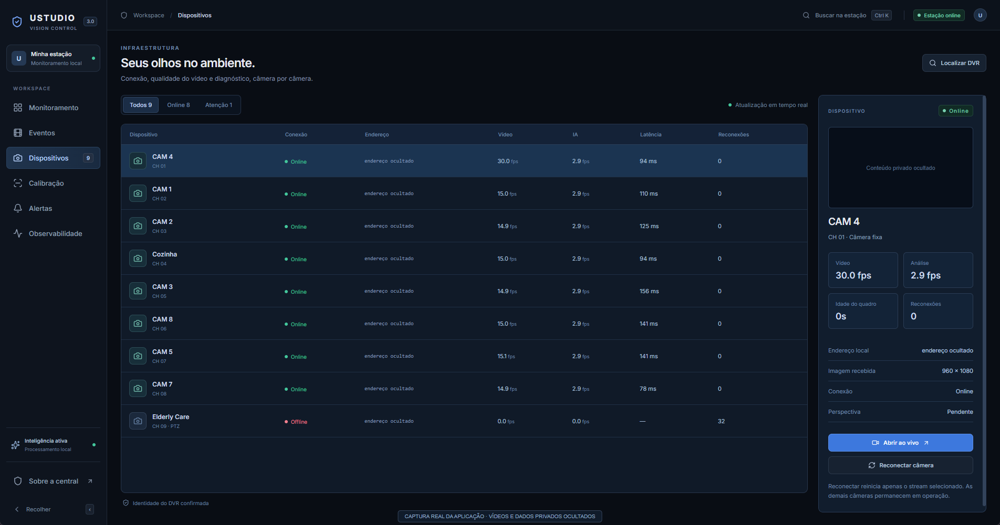

# Câmeras e conectividade

## Compatibilidade efetiva

A integração foi usada com um DVR Intelbras MHDX 1208 de oito canais e uma câmera IP adicional com stream de família compatível com o caminho abaixo. A câmera extra não foi identificada por modelo/fabricante de forma confiável. Não há matriz de homologação ampla.

| Origem | Implementação |
|---|---|
| DVR | RTSP TCP na porta 554, `/cam/realmonitor?channel=N&subtype=0`; títulos por CGI HTTP com autenticação Digest. |
| Câmera adicional | RTSP na porta 554, caminho `/user=..._password=..._channel=1_stream=0.sdp?real_stream`; mesma credencial do DVR. |
| Descoberta/recuperação | ONVIF WS-Discovery na rede local e verificação da identidade do DVR pareado. |
| PTZ adicional | SOAP/WS-Security em HTTP, porta 8899, `/onvif/ptz_service`, perfil fixo `PROFILE_000`; mover/parar/posição inicial. |

Os caminhos e o perfil PTZ são específicos; ONVIF não significa suporte universal ou descoberta dinâmica de qualquer perfil. Não há zoom ótico exposto, áudio, talkback, descoberta genérica de URLs, importação de DVRs adicionais ou coleção ilimitada de câmeras no desktop.

## Configurar os canais

No `.env` privado da pasta pai, configure `DVR_HOST`, `DVR_USER`, `DVR_PASSWORD` e `DVR_CHANNEL_COUNT=8`. `EXTRA_CAMERA_HOST` vazio desativa a câmera extra; preenchido cria o próximo canal, normalmente CH09. As URLs autenticadas são montadas internamente e não devem ser copiadas para logs ou issues.

O stream principal é solicitado com `subtype=0`. A resolução efetiva vem do equipamento: configurar Full HD exige que a câmera/DVR ofereça esse stream. O software não transforma uma fonte de menor resolução em Full HD real. Alguns canais do DVR entregam 960×1080 anamórfico; a apresentação corrige seu aspecto, enquanto a calibração usa a imagem bruta.

Para adicionar equipamento de outro protocolo/caminho ou mais de uma câmera extra é necessário adaptar a integração e testar. `CAMERA_URL` pertence ao modo legado de câmera única e não adiciona canais ao mosaico.

## Diagnóstico e recuperação



Dispositivos mostra conexão, FPS, idade do quadro, latência dos resultados e reconexões, com preview contextual. A ação **Reconectar câmera** reinicia somente a captura selecionada. **Localizar DVR** pede ao serviço de recuperação uma busca pelo dispositivo pareado; não autoriza substituir o DVR por qualquer host encontrado.

Estados internos incluem `connecting`, `online`, `stalled`, `network_error`, `auth_error`, `stream_error`, `reconnecting` e `stopped`. Para diagnosticar a porta, use somente hosts que você administra; o endereço abaixo é ilustrativo:

```powershell
Test-NetConnection -ComputerName 192.0.2.10 -Port 554
```

Uma porta aberta não comprova autenticação nem stream válido. Confira credenciais, permissões de vídeo, configuração de codec e limite de conexões no equipamento. Não publique a saída com seu IP real.

## PTZ e calibração

Os controles aparecem ao ampliar a câmera extra quando integrada. Pressionar movimenta; soltar/cancelar envia parada, e o comando possui timeout. Se estiver desligada, o movimento fica indisponível.

Movimentos iniciados pelo UVision invalidam as zonas do canal para impedir novas confirmações com a geometria anterior. Movimentos por outro aplicativo não são detectados automaticamente: recalibre após qualquer mudança de enquadramento. Na revisão documental, o movimento físico não foi repetido porque essa câmera estava desligada.

Use rede local protegida. Não encaminhe portas de RTSP/ONVIF/CGI para a internet. Credenciais com acesso mínimo, firmware e segmentação de rede são discutidos em [SECURITY.md](../SECURITY.md).
