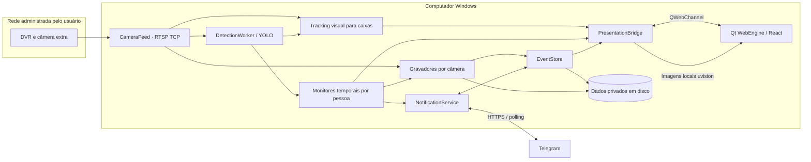

# Componentes e fronteiras

Este diagrama detalha a [arquitetura principal](../architecture.md). O servidor HTTP legado não participa desta entrada desktop.

A rede de câmeras pode usar protocolos sem criptografia de transporte; a execução local não torna essa rede automaticamente segura. O único serviço externo mostrado é o Telegram opcional. Não existe reconhecimento facial ou identidade biométrica neste fluxo.
