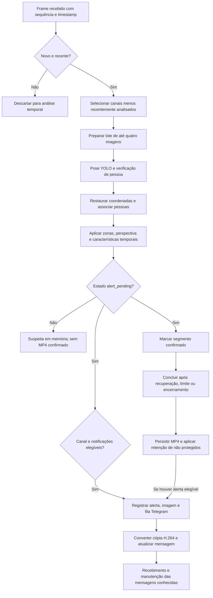

# Fluxo de processamento e confirmação

Captura, análise, desenho e gravação têm cadências diferentes. A confirmação não espera o upload e o recebimento não valida o bem-estar da pessoa. Perda de evidência reinicia o tempo no chão; a caixa suavizada da apresentação não entra nesse cálculo.
