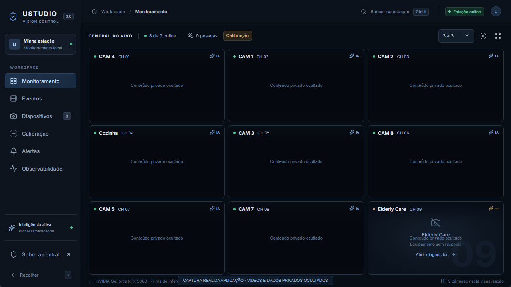

# Galeria da aplicação real

Capturas feitas em 19/11/2026 na interface 3.0 em execução, com oito canais reais conectados e a câmera adicional desligada. Não são mockups, dados simulados ou imagens geradas por IA.

**Privacidade:** vídeos, miniaturas e imagem/marcações do ambiente de calibração foram ocultados no frontend antes de capturar. IPs, token, IDs pessoais e datas privadas também foram ocultados. As capturas incluem uma indicação dessa ocultação; as regiões vazias não significam falha dos streams. Não foram publicadas capturas históricas da instalação.

| Vista | Captura | O que observar |
|---|---|---|
| Dashboard principal | [dashboard.png](dashboard.png) | Mosaico 3×3, navegação, contagem e estado dos canais. |
| Monitoramento múltiplo | [monitoring.png](monitoring.png) | Modo operacional com maior área útil para os nove cards. |
| Câmera individual | [camera-detail.png](camera-detail.png) | Ampliação de um canal e retorno ao mosaico. |
| Histórico de eventos | [recordings.png](recordings.png) | Biblioteca real com filtros e revisões existentes, sem miniaturas privadas. |
| Reprodução | [playback.png](playback.png) | Player em funcionamento, timeline, duração e inspector. |
| Alertas | [alerts.png](alerts.png) | Estado da integração e eventos do histórico. |
| Configuração de alertas | [alert-settings.png](alert-settings.png) | Seleção visual de canais e formulário com segredos ocultados. |
| Calibração | [calibration.png](calibration.png) | Ferramentas e parâmetros; a imagem/geométrica privada não é compartilhada. |
| IA | [ai-performance.png](ai-performance.png) | Métricas e gráficos reais da sessão, sem demonstração de precisão. |
| Dispositivos | [devices.png](devices.png) | Conexão, FPS, latência, reconexões e inspector; endereços ocultados. |

## Demonstração curta

A animação é uma gravação da janela real durante a navegação entre páginas, com a mesma proteção aplicada antes de gravar. Não é uma montagem de screenshots ou uma simulação dos serviços. O conteúdo dos vídeos permanece ocultado e o ensaio não envolve gerar queda ou enviar aviso Telegram.

Para substituir as capturas por streams visíveis, o responsável precisa fornecer uma câmera/cena autorizada, sem pessoas identificáveis ou dados privados. Nenhuma autorização para publicar imagens dos ambientes foi presumida.
