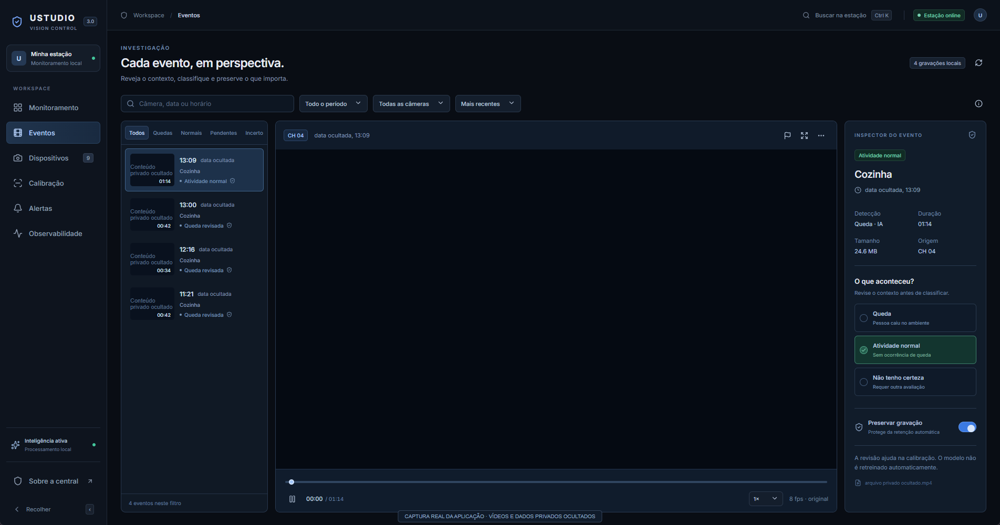

# Gravações e eventos

## Quando um MP4 é criado

`FallClipRecorder` existe por canal habilitado. Mantém um buffer JPEG circular dos frames anteriores. Ao observar `possible_fall`, `down` ou `alert_pending`, passa a guardar o segmento em memória. Somente uma sequência que alcançou **`alert_pending`** é elegível para ser salva.

Uma suspeita sem confirmação é descartada. Depois de retornar a `normal`, o gravador espera o tempo posterior configurado; se voltar a um estado ativo, o prazo é reiniciado. Há encerramento também ao atingir aproximadamente 120 segundos de frames ou ao fechar o aplicativo. No encerramento, segmentos confirmados podem ser finalizados; suspeitas continuam sendo descartadas.

| Parâmetro | Padrão |
|---|---|
| Buffer anterior | 8 segundos |
| Tempo posterior | 8 segundos **após retornar ao normal** |
| FPS do arquivo | 8 |
| Codec local | OpenCV `mp4v`, contêiner MP4 |
| Retenção | 30 clipes não protegidos por câmera |

O FPS do arquivo não é o FPS do YOLO. Frames repetidos não são anexados novamente, e o limite do segmento é por contagem de frames; quedas de cadência podem afetar a relação entre duração codificada e tempo de parede.

## Arquivos e histórico

Clipes ficam em `recordings/falls/queda-chXX_AAAA-MM-DD_HH-MM-SS.mp4`, com data/hora local do início da suspeita. O gravador escreve um arquivo temporário e o renomeia ao concluir. Não há gravação contínua de todas as câmeras nem upload automático fora da integração Telegram habilitada.

`runtime/events.json` registra revisões, proteção e alertas/entregas. Não é uma cópia dos vídeos. Faça backup **dos arquivos e desse histórico** para conservar a associação e as decisões de revisão. Nenhum desses diretórios deve entrar em commits.

## Investigar pela interface

A página Eventos reúne lista, player e inspector. Filtre câmera, período, busca e estado de revisão; ordene para localizar o caso. O player oferece reprodução/pausa, seek, velocidade 0,5×/1×/1,5×/2×, expansão e abertura externa do original/pasta.

`Espaço` reproduz/pausa quando o player está em foco; `Esc` sai da expansão. O botão de marcador adiciona um ponto manual na sessão. Esses pontos não são persistidos nem estimam automaticamente o instante da queda. O player atual não reproduz áudio.

Classificações disponíveis: `fall` (queda), `normal` (atividade normal), `unsure` (incerto), ou sem revisão. Revisar pela interface protege o arquivo por padrão. Preservação também pode ser ajustada explicitamente no inspector. São rótulos operacionais, não anotações de todos os frames nem retreinamento do YOLO.

## Retenção e proteção

Ao salvar um novo clipe, o gravador ordena os arquivos daquele canal pela modificação e remove os não protegidos além de `FALL_VIDEO_MAX_FILES`. O padrão é 30 **não protegidos por canal**, não 30 no total, nem “30 dias”. Arquivos protegidos ficam além desse limite.

Também são protegidos clipes associados a alertas sem recebimento confirmado ou com entrega inicial feita e vídeo ainda pendente. Confirmar recebimento não remove a proteção manual de uma revisão. Não há cota por gigabytes nem liberação automática de espaço com base no disco livre. Arquivos protegidos, cache Telegram, imagens de alertas e logs podem crescer.

Para evitar perda de material importante, preserve na interface e faça backup privado fora da pasta sujeita à retenção. Verifique disco livre, permissões e recuperação do backup. Não apague `runtime/events.json` para “limpar” notificações: isso perde associações, revisões e proteções.

## Vídeo no Telegram

O MP4 local permanece intacto. Para o celular, FFmpeg cria uma cópia H.264 baseline/yuv420p com faststart em `runtime/telegram-videos`, sem áudio, e o serviço reutiliza essa cópia nas tentativas. O aplicativo recusa anexos acima do seu limite interno de 48 MiB. Uma falha de conversão não significa que o original local tenha sido perdido; consulte [alertas](alerts.md) e [troubleshooting](troubleshooting.md).
